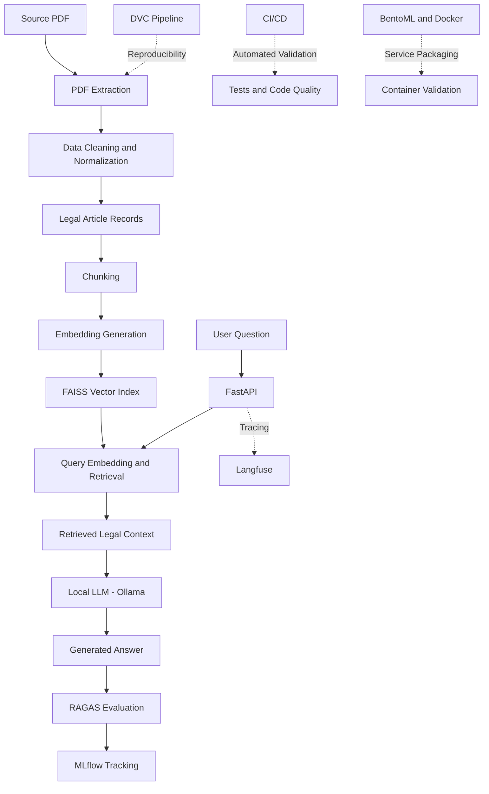

# Egyptian Civil Code RAG

**A Bilingual Legal Retrieval-Augmented Generation (RAG) System with MLOps, Evaluation, and Observability**

An end-to-end RAG project that extracts and processes the Egyptian Civil Code in Arabic and English, retrieves relevant legal articles, and generates context-grounded answers using a locally hosted language model. The project integrates MLOps practices for reproducibility, experiment tracking, automated validation, evaluation, and observability.

## Table of Contents

- [Overview](#overview)
- [Key Features](#key-features)
- [Architecture](#architecture)
- [Technology Stack](#technology-stack)
- [Data Pipeline](#data-pipeline)
- [RAG Workflow](#rag-workflow)
- [Evaluation](#evaluation)
- [MLOps and Observability](#mlops-and-observability)
- [Project Structure](#project-structure)
- [Prerequisites](#prerequisites)
- [Installation](#installation)
- [Running the API](#running-the-api)
- [Testing and Code Quality](#testing-and-code-quality)
- [Reproducibility](#reproducibility)
- [Project Status](#project-status)
- [Limitations](#limitations)
- [Disclaimer](#disclaimer)

## Overview

Legal documents require accurate retrieval, careful handling of source text, and answers grounded in relevant legal provisions. This project explores how Retrieval-Augmented Generation can support access to bilingual Egyptian Civil Code content while incorporating engineering practices for evaluation, monitoring, and reproducibility.

The system combines document processing, semantic search, local language-model inference, API serving, automated checks, experiment tracking, and observability in a modular workflow.

The project emphasizes not only generating answers but also inspecting retrieval behavior, evaluating response quality, tracking experiments, and validating code changes.

## Key Features

- **Bilingual legal corpus:** Processes Arabic and English content from the Egyptian Civil Code.
- **Document extraction:** Extracts structured legal content from PDF tables using PyMuPDF.
- **Semantic retrieval:** Uses BAAI/bge-m3 embeddings and FAISS for similarity-based search.
- **Local LLM inference:** Uses Qwen2.5:3b through Ollama.
- **Retrieval-Augmented Generation:** Grounds generated responses in retrieved legal context.
- **FastAPI:** Provides an API interface for querying the RAG system.
- **DVC:** Supports data and pipeline versioning and reproducibility.
- **MLflow:** Tracks experiments and evaluation metrics.
- **RAGAS:** Evaluates RAG quality using metrics such as faithfulness, answer relevancy, context precision, and context recall.
- **Langfuse:** Supports tracing and observability of RAG requests.
- **CI/CD:** Automates configured checks and validation.
- **Testing and code quality:** Uses pytest and Ruff.
- **BentoML and Docker:** Supports service packaging and containerization.

## Architecture

The project follows a modular pipeline:



## Technology Stack

| Component | Technology |
|---|---|
| Programming language | Python 3.13 |
| Dependency management | uv |
| Document extraction | PyMuPDF |
| Embedding model | BAAI/bge-m3 |
| Vector search | FAISS |
| Language model | Qwen2.5:3b |
| Local inference | Ollama |
| API framework | FastAPI |
| Data and pipeline versioning | DVC |
| Experiment tracking | MLflow |
| RAG evaluation | RAGAS |
| Observability and tracing | Langfuse |
| Testing | pytest |
| Linting | Ruff |
| Service packaging | BentoML |
| Containerization | Docker |
| Automation | CI/CD |

## Data Pipeline

The source corpus is a bilingual PDF containing Egyptian Civil Code material.

The processing pipeline includes:

1. Extracting table content from the PDF.
2. Structuring extracted content into legal article records.
3. Normalizing text and correcting detected Arabic numeral issues.
4. Identifying empty fields, missing translations, and repealed provisions.
5. Building processed data artifacts for chunking and retrieval.

The initial extraction processed approximately 170 PDF pages and produced approximately 1,149 article records. These figures describe the current extracted corpus and may change as data cleaning and validation progress.

Data-quality profiling is used to identify incomplete records and potential extraction issues before relying on the corpus for generation.

## RAG Workflow

The RAG workflow consists of the following stages:

1. **Question input:** The user submits a legal question through the API.
2. **Query representation:** The question is converted into an embedding.
3. **Semantic retrieval:** FAISS retrieves relevant chunks from the indexed legal corpus.
4. **Context construction:** Retrieved passages are assembled into the prompt context.
5. **Answer generation:** Qwen2.5:3b generates a response using the retrieved context.
6. **Grounding and citations:** The prompt is designed to keep answers grounded in the available context, provide legal references where supported, and abstain when the evidence is insufficient.
7. **Observability:** Langfuse supports inspection of request traces and pipeline behavior.
8. **Evaluation:** RAGAS metrics help assess response quality and retrieval performance.

The system's output should always be checked against the original legal text.

## Evaluation

The project uses RAGAS to evaluate the quality of generated answers and retrieved context.

An initial, limited evaluation produced the following results:

| Metric | Initial Result |
|---|---:|
| Faithfulness | |
| Answer Relevancy | |
| Context Precision ||
| Context Recall | |

These values are preliminary results from a limited evaluation run, not a comprehensive benchmark of the system.

A larger evaluation was constrained by local CPU and memory resources. Further evaluation using a larger and more representative question set is needed before drawing conclusions about overall RAG quality.

The evaluation workflow is designed to support repeatable measurements and experiment tracking through MLflow.

## MLOps and Observability

### DVC — Data and Pipeline Versioning

DVC is used to manage pipeline stages and support reproducibility of data-processing and model-preparation workflows. Remote artifact retrieval requires the relevant remote configuration and credentials.

### MLflow — Experiment Tracking

MLflow records evaluation runs and metrics, helping compare experiments and track changes in system performance.

### RAGAS — RAG Quality Evaluation

RAGAS is used to evaluate answer faithfulness, answer relevancy, and the quality of retrieved context. Evaluation results should be interpreted in light of dataset size and hardware constraints.

### Langfuse — Tracing and Observability

Langfuse is integrated with the RAG workflow to provide observability into request execution.

It supports inspecting traces and investigating pipeline behavior, helping identify issues in retrieval and generation. The specific trace fields and metrics available depend on the instrumentation configured in the project.

### CI/CD — Continuous Integration and Delivery

The CI/CD workflow automates the checks configured in the repository to help maintain code quality and detect regressions. It supports a more reliable development process by validating changes through repeatable automated checks.

### BentoML and Docker — Service Packaging

BentoML is used as part of the service-packaging workflow, with Docker intended to provide a portable containerized runtime.

The Docker image build and end-to-end container execution must be validated separately before the containerized service can be considered deployment-ready.

## Project Structure

The repository is organized around the following components. Exact filenames and directories may vary with the current implementation.

```text
egyptian-civil-code-rag/
├── data/
│   ├── raw/
│   └── processed/
├── docs/
├── scripts/
│   ├── extract_egyptian_civil_code.py
│   ├── build_chunks.py
│   ├── build_embedding.py
│   ├── build_faiss.py
│   ├── evaluate_rag.py
│   ├── evaluate_retrieval.py
│   ├── profile_corpus.py
│   └── mlflow_baseline.py
├── src/
│   └── rag/
│       └── ...
├── tests/
├── dvc.yaml
├── dvc.lock
├── pyproject.toml
├── uv.lock
└── README.md
```

The repository also includes evaluation, monitoring, and service-related components. Refer to the actual source tree for the complete and current implementation.

## Prerequisites

Before running the project, ensure that you have:

- Python 3.13.
- uv for dependency management.
- Ollama installed for local language-model inference.
- Git.
- Access to the project data artifacts, either locally or through the configured DVC remote.
- Sufficient CPU and memory resources for the embedding, retrieval, and inference workloads.

A GPU is not required by the basic local workflow, but hardware limitations can affect performance and the size of evaluation runs that can be completed.

## Installation

### 1. Clone the repository

Replace the placeholder with your actual GitHub repository URL.
## Installation

### Prerequisites

- Python 3.13
- [uv](https://docs.astral.sh/uv/)
- [Git](https://git-scm.com/)
- [Ollama](https://ollama.com/)
- Internet access for downloading model files
- Authorized access to the configured DVC remote, unless all required artifacts are already available locally

The basic workflow supports CPU execution. A GPU is not required, although local inference and embedding initialization may be slower on CPU.

### 1. Clone the repository

```bash
git clone https://github.com/Dinas33/egyptian-civil-code-rag.git
cd egyptian-civil-code-rag
```

### 2. Install dependencies

```bash
uv sync --locked --extra dvc
```

### 3. Download the local language model

Ensure Ollama is installed and running, then execute:

```bash
ollama pull qwen2.5:3b
```

### 4. Download the embedding model

The project uses `BAAI/bge-m3` through SentenceTransformers.

The model is downloaded automatically when the embedding component initializes if it is not already cached locally. Internet access is required for the initial download.

### 5. Retrieve DVC artifacts

The project stores its DVC artifacts on an S3-compatible IDrive e2 remote.

Configure valid access credentials in the execution environment, then run:

```bash
uv run --extra dvc dvc pull
```

The remote requires authorized credentials. Do not commit access keys, secret keys, or `.env` files to Git.

## Running the API

From the repository root, start the FastAPI application:

```bash
uv run uvicorn rag.api:app --app-dir src --host 127.0.0.1 --port 8000
```

Keep the server terminal open.

Check the health endpoint:

```bash
curl http://127.0.0.1:8000/health
```

Open the interactive API documentation:

http://127.0.0.1:8000/docs

Use `POST /ask` to submit a question and inspect the generated answer and retrieved sources.

Press `Ctrl+C` in the server terminal to stop the application.

## Reproducibility

The project uses versioned dependencies and pipeline tooling to improve repeatability:

- `pyproject.toml` defines project metadata and dependencies.
- `uv.lock` locks the dependency versions.
- `dvc.yaml` defines the configured data pipeline stages.
- `dvc.lock` records the resolved pipeline state and relevant artifact information.
- MLflow records evaluation runs and metrics.
- CI/CD executes configured automated validation checks.

Reproducibility depends on having the required data artifacts, model files, configuration, and credentials available in the execution environment.

## Project Status

| Component | Status |
|---|---|
| Bilingual PDF extraction and processing | Implemented |
| Chunking, embeddings, and FAISS retrieval | Implemented |
| Local LLM integration | Implemented |
| FastAPI integration | Implemented |
| DVC pipeline | Implemented |
| MLflow experiment tracking | Implemented |
| RAGAS evaluation | Integrated; initial limited evaluation completed |
| Langfuse observability | Integrated |
| CI/CD | Completed and tested |
| BentoML Docker image build | Remaining validation step |
| End-to-end container runtime validation | Remaining validation step |

The project is progressing from a locally implemented and instrumented RAG pipeline toward a fully validated containerized service.

## Limitations

- Initial evaluation results are based on a limited question set and should not be interpreted as definitive performance measurements.
- Local CPU and memory resources limit the practical size and speed of some evaluation workloads.
- Extraction errors, missing translations, and incomplete source records can affect retrieval quality.
- Generated answers can still be incomplete or incorrect, even when retrieved context appears relevant.
- Access to remote DVC artifacts depends on the availability of correctly configured credentials.
- Containerized deployment readiness depends on successful BentoML packaging and Docker runtime validation.


## Author

Developed as an MLOps and Retrieval-Augmented Generation project focused on bilingual legal document processing, evaluation, and observability.